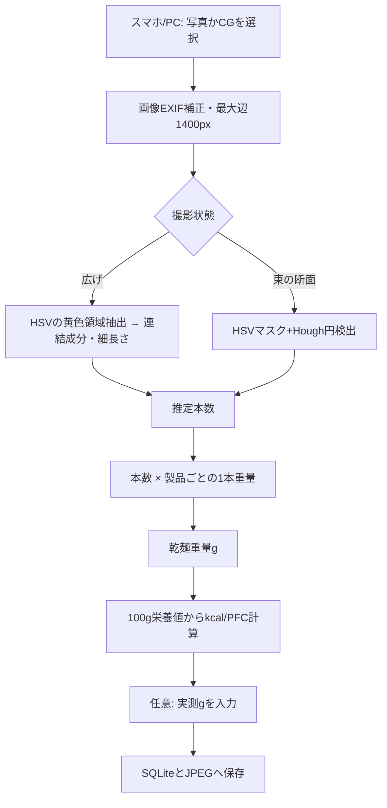

# 03 現状のコード構造とデータフロー（As-Is）

## 技術スタック
- Python 3.11/3.12 を想定（ユーザーWindows環境でPython 3.11のパッケージログを確認）。
- Streamlit UI、OpenCV (`opencv-python-headless`)、NumPy、Pillow、pandas、標準 `sqlite3`。
- 現在の `requirements.txt` は範囲指定。将来は互換バージョンの固定やCIを検討。

## ファイル
- `app.py`：Streamlit画面、入力、検出、計算、保存UI。
- `pasta_vision.py`：`image_to_rgb`, `detect_spread`, `detect_bundle_ends`, `nutrition_for_weight`。
- `storage.py`：`init_db`, `list_products`, `save_product`, `save_measurement`, `list_measurements`。
- `generate_demo.py`：12本の広げた麺、16個の断面のCG生成。
- `sample_images/`：CG画像のみで**実物写真ではない**。
- `tests/test_core.py`：4つの単体テスト。
- `start_windows.bat`：依存導入、Streamlit起動（`py` がなければ `python` を使う）。

## 現状の処理


## DB（SQLite）
`products(id, name UNIQUE, g_per_strand, kcal_100, protein_100, fat_100, carb_100)`

`measurements(id, created_at, product_name, mode, detected_count, estimated_g, actual_g NULL, kcal, protein_g, fat_g, carb_g, image_filename)`

- 初回DB作成でデモ製品を挿入：1本1g、350kcal/100g **すべて架空デモ値**。
- 画像ファイルは実行時に `data/photos/*.jpg` に保存される（ZIPには含まれない）。
- `measurements.product_name` はテキスト保存。今後は `product_id`/モデル版/推定器名/ラベル品質も記録すると再現性向上。
- 複数ユーザー・Web公開のアクセス制御は未実装。

## 既知の技術的課題
1. **広げモード**は「黄色く細長い**独立した領域**」を1本と数える。接触・交差・重複したら1個に融合し過少計数。麺が背景と同系色でも失敗。
2. **束モード**は断面に見える円をHough変換で数える。麺内部が隠れると見えない。ノイズ・照明・焦点で誤検出。
3. 距離・解像度ごとに `min_area`、`min_radius` などのピクセル閾値が変わりやすい。
4. 推定不能判定は限定的。誤った本数でも重量・カロリー表示可能。
5. CGで通ることと実写真で通ることは別。実写真での検出率・MAEは未測定。
6. Streamlitの `use_container_width` が非推奨という警告を、ユーザーの起動ログで確認。対象バージョンのAPIを確かめて `width` へ置換検討。
7. 測定履歴の画像とDBの保存・削除・バックアップ、将来のデータ移行に改善余地あり。

## 再現テスト（本引継ぎ資料の作成時）
```bash
cd pasta_weight_app_v2
python -m pytest -q tests/test_core.py
# 実行結果: 4 passed (2026-10-28)
```
この検証は、cv2・NumPy等を読み込める環境で行った。StreamlitのブラウザUI動作は当該環境で**未テスト**。ユーザーのWindowsではアプリのサーバー起動ログを確認済み。
