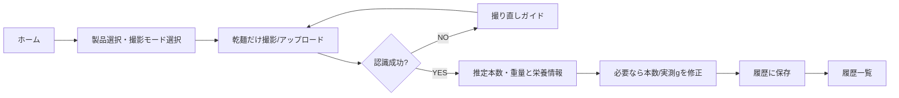

# 10 必要な画面・利用の流れ

## 画面候補
1. **ホーム/測定画面**：撮影方法（広げ・束）選択、サンプル・画像アップロード・カメラ撮影、製品選択。
2. **プレビュー・解析画面**：撮影画像、検出箇所の赤枠／赤丸、検出失敗時のガイド、本数手動修正。
3. **測定結果画面**：推定本数、推定重量g、カロリー、P/F/C、実測g入力、誤差、保存。
4. **履歴一覧・詳細画面**：日時、製品名、推定g、実測g、誤差、写真、撮影モード。
5. **パスタデータ画面**：製品と校正値、100g栄養情報の登録・更新。
6. **使い方・撮影ガイド**：適用条件、撮影例、精度についての注意。
7. **（後日）学習・評価管理画面**：データアップロード、学習状況、MAE等。ただし最初はCLIで十分。

## 利用シーン：食事前に乾麺の量を知りたい

**実装面**：現在のStreamlit UIは4タブで構成され、撮影／推定を一つのタブに含む。上の画面は**機能上の画面**なので、必ずしも物理的に別ルートにする必要はない。
