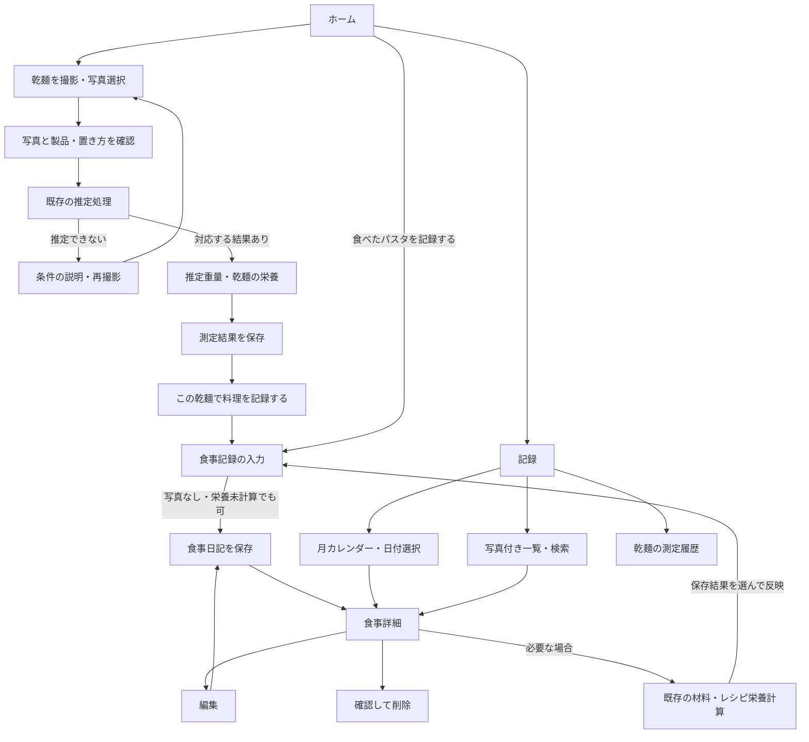
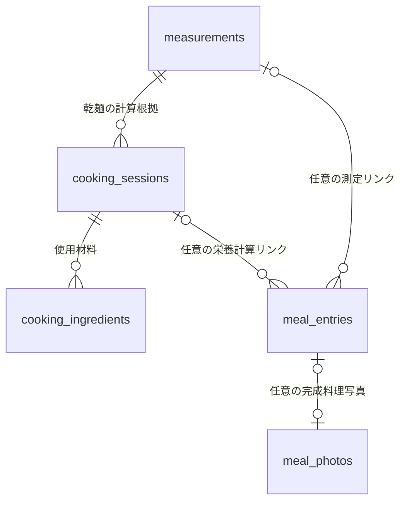
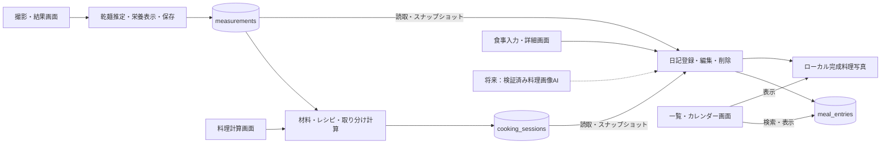

# Pasta Lens 食事日記・UI設計変更

乾麺の測定記録、料理の栄養計算、実際に食べた料理の日記を別々に保持し、必要なときに関連付けます。測定しただけの乾麺は食事日記に入りません。今回の改修範囲はUI、日記、保存・連携処理です。乾麺推定アルゴリズム、学習画像、モデル学習は変更しません。

## 画面構成

|画面|主な操作|表示・保存する情報|
|---|---|---|
|ホーム|「乾麺の重さをはかる」「食べたパスタを記録する」|最近の食事記録。空の状態では始め方を案内|
|乾麺撮影|カメラ／写真選択、プレビュー、置き方と製品を確認して解析|広げた状態・断面などの対応条件。前回の製品を初期候補にする|
|重量結果|結果保存、任意の実測重量、「この乾麺で料理を記録する」、再撮影|推定g、乾麺分のkcal/PFC、製品、推定値である旨|
|食事記録|写真（任意）、料理名、日付、任意の時刻・食事区分・メモ、保存|乾麺・料理計算への任意リンクと当時のスナップショット|
|記録|カレンダー／写真付き一覧、日付・料理名検索、詳細|同日の複数の食事。乾麺履歴は別の表示へ切替|
|食事詳細|編集、削除、必要に応じて料理の栄養計算へ|写真・食事日時・メモ、引き継いだ重量、栄養の根拠|
|設定|表示テーマ、撮影ガイド、製品管理、既存料理計算、開発・検証ツール|通常設定と研究用機能を分離|

基本ナビゲーションはホーム／記録／設定です。計算フォームを最初から日記の必須入力にはしません。食事写真から料理名・材料・栄養を自動認識したような表示は行いません。

クリーム・オフホワイトの背景、セージグリーン、角丸カード、大きな操作ボタンを共通CSSで統一します。ライト／ダーク／端末追従のテーマを用意します。カレンダーの日付は写真リストの絞り込みに使い、食事のない日からも記録を始められます。

## 画面遷移



## データの責務

|データ|意味|日記保存時の扱い|
|---|---|---|
|`products`|製品の校正値・栄養値|変更しない|
|`measurements`|乾麺の推定・実測・写真・当時の製品情報|任意に関連付け、当時の値を日記へ複写。元の測定は更新しない|
|`cooking_sessions` / `cooking_ingredients`|確認済みの乾麺、材料量、取り分け、計算根拠と結果|任意に関連付け、計算のスナップショットを保存。元の料理は更新しない|
|`recipe_templates`|出典と分量の前提を持つ利用者登録レシピ|既存の料理計算で再利用|
|`meal_entries`|実際に食べた料理の日付・名称・写真・メモ|今回の主な追加データ|

同じ料理名を同日に複数回記録できます。日記を追加することと、同じ乾麺測定から料理計算を二重保存することは別です。料理計算側の同一測定IDの二重使用拒否を維持します。日記から測定や料理計算を自動生成・更新しません。



`cooking_sessions` の旧重複行は消しません。新規保存は既存のトランザクション内の検査によって一つの測定IDにつき一件に制限します。`meal_photos` はテーブルではなくローカル写真保存先を表す概念です。

## 栄養表示の契約

|状態|表示|計算の根拠|
|---|---|---|
|未計算|「未計算」|リンクや計算根拠がない。値はNULLであり0kcalではない|
|乾麺分のみ|乾麺分と明示したkcal/PFC|測定時の製品栄養と乾麺量。ソース・油・具材を含まない|
|材料による計算|入力した材料・使用量による計算と表示|既存料理計算の取り分け後の値と計算全体を保存|
|参考レシピ|参考レシピによる概算と表示|テンプレートの出典・基準分量・入力材料・取り分け|
|将来の画像AI|現在は「写真AIによるカロリー推定は準備中」|学習・独立評価済みのモデルを将来接続するための境界のみ|

乾麺の推定重量と実測重量は異なる項目として引き継ぎます。既存計算と同様、実測重量があれば栄養計算に優先して使い、推定重量は消しません。製品情報や元履歴が後から変わっても、日記に保存した計算根拠を表示します。CG・デモ由来の測定から続けた日記は実測由来と区別します。

## 詳細設計書へ反映する機能

受領ファイルとリポジトリ内には、授業の「基本設計書Ver.2」原本および教員指定の詳細設計書様式を確認できませんでした。以下は依頼で明示された必須機能との対応表です。原本の項番・様式との最終照合は別途必要です。過去の `docs/01`〜`13` は引き継ぎ当時の資料なので、現在の実装済み／未実装の判断には本資料とコードを参照してください。

|要件|画面|主なコード／データ|変更区分|
|---|---|---|---|
|写真撮影・画像受付|乾麺撮影|`capture_ui.py`、既存画像読込|必須機能を維持|
|パスタ重量推定|重量結果|既存OpenCV／回帰処理|処理自体は今回変更しない|
|栄養情報表示・カロリー計算|重量結果／料理計算|`measurement_ui.py`、`cooking.py`|計算を再利用|
|食品データ登録・更新|設定の製品管理|`settings_ui.py`、`products`|維持|
|測定履歴保存・閲覧|重量結果／記録の乾麺履歴|`storage.py`、`history_ui.py`、`measurements`|維持・日記への導線追加|
|エラー通知・再実行案内|撮影／保存画面|各UIの入力検証・保存失敗案内|維持・日記へ追加|
|完成料理写真保存|食事記録／詳細|写真処理・保存層、ローカル画像|拡張要件|
|食事日時・日記|食事記録／詳細|`diary_ui.py`、`meal_diary.py`、`meal_entries`|拡張要件|
|カレンダー・写真付き一覧・検索|記録|`diary_ui.py`|拡張要件|
|料理画像AIの接続構造|現在は準備中表示|共通インターフェース、モデル情報・品質判定|将来拡張。予測モデルは未実装|



## 起動・データ分離

Windowsのコマンドプロンプトでリポジトリ直下から実行します。`py` ランチャーは必須ではありません。

```bat
python -m venv .venv
.venv\Scripts\python -m pip install -r pasta_weight_app_v2\requirements-dev.txt
.venv\Scripts\python -m streamlit run pasta_weight_app_v2\app.py --server.address 127.0.0.1
```

通常の保存先は `pasta_weight_app_v2/data/`、DBはその中の `measurements.sqlite3` です。授業の実演用には、アプリを起動する前に独立した保存先を指定します。

```bat
set "PASTA_DATA_DIR=%LOCALAPPDATA%\PastaLens\class-demo"
.venv\Scripts\python -m streamlit run pasta_weight_app_v2\app.py --server.address 127.0.0.1
```

個人データをコピーしない新規フォルダーを使ってください。デモ製品・CG測定は実測データではありません。個人利用へ戻すときはアプリを停止し、同じコマンドプロンプトで `set "PASTA_DATA_DIR="` を実行してから起動します。既存の `start_windows.bat` も残します。

写真とDBの保存先はアプリを実行しているPCです。別端末から接続しても、写真はそのPCのアプリへ送信されます。公開認証は追加していません。開発・検証機能を別画面にすることはアクセス制御ではありません。外部接続の実演には個人データのない独立環境、または別途設定したアクセス制御を使ってください。

## 検証と成果物

自動テストは一時DB・テスト画像を使用し、個人用DB・学習写真・モデルを変更しません。次のコマンドで全Pythonテストを実行します。

```bat
.venv\Scripts\python -m pytest -q pasta_weight_app_v2\tests
```

Linuxでは `.venv/bin/python -m pytest -q pasta_weight_app_v2/tests` を使用します。Chromium／Playwrightの操作検証と画面プレビューは別の独立データ環境で採取します。プレビューに含まれる数値・写真はテスト用で、実写での推定精度の証拠ではありません。

最終検証：Pythonの全270件が成功（既存261件＋日記9件）。Chromiumの26画面・状態チェックが成功。保存エラーは隔離DBのトリガーで再現し、入力保持と再保存を確認しました。幅375/390/430/768/1440px、ライト／ダーク、写真アップロード、測定→日記→料理計算→日記、同日複数記録、検索・編集・削除を確認しています。画面プレビューは検証環境の `/workspace/scratch/pasta-diary-release/index.html`、画像一式は `/workspace/scratch/Pasta-Lens-UI-previews.zip` に保存しました。これらの画面はCGとデモ値による操作確認です。スクリーンショット・DB・ログはGitHubへコミットしません。自動テストの成功とスマートフォン実機の動作確認は別です。iPhone Safari／Android Chromeの実カメラ、権限ダイアログ、ソフトキーボード、Windows実機、外部トンネル接続は、個別に実測していない限り未検証として扱います。

## 今回実装しないもの

- 完成料理写真からの料理名・材料量・カロリー推定。学習済みモデル、正解データ、独立評価はありません。
- 新しい乾麺推定方式、再学習、実写精度の改善判定。
- アカウント管理、無認証で安全に公開できる仕組み。
- 別の測定IDで同じ物理的な乾麺を二重撮影したことの自動識別。

将来の料理画像AIは、料理写真に対応する材料・使用量・カロリーの信頼できる正解データを用意し、独立評価を経て接続します。写真の受付・正規化と保存、推定器、栄養の根拠管理を分け、未対応・低品質・モデル未学習時は数値を返さない契約を維持してください。

## DB設計と移行・復元

`meal_entries` の主キー `id` はフォーム作成時のUUIDです。同じ送信IDを再送しても既存行を返し、編集は明示した更新として扱います。更新日時が変わった場合は古い画面からの上書きを拒否します。削除は `deleted=1` とし、元の測定・料理・写真を削除しません。

|列|型・意味|
|---|---|
|id|TEXT 主キー、保存の重複防止にも使用|
|eaten_date / eaten_time / eaten_at|日付、任意の時刻、時刻ありの場合の+09:00日時。日付だけの記録を深夜0時と偽らない|
|dish_name / meal_type / memo|料理名、任意の食事区分、メモ|
|photo|任意の料理写真キー。相対パスの入力は拒否|
|created_at / updated_at|UTCの登録・更新日時。食べた日時と別|
|measurement_id / cooking_session_id|任意の既存履歴への関連。存在と対応を保存時に確認|
|measurement_snapshot_json|推定・実測重量、製品・栄養情報など保存時の測定値|
|nutrition_status / nutrition_source / nutrition_snapshot_json|栄養の区分、根拠、取り分け値と再現に必要な計算内容。未計算時はJSON null|
|source_kind|実写・CG・来歴不明。日記の写真が実測を証明するものではない|
|deleted|0=表示、1=削除済み|

DBの初回日記テーブル追加・旧基礎実装からの列追加は、SQLiteのバックアップAPIで整合性を確認したコピーを作った後、一つのトランザクションで行います。バックアップに失敗すると移行を中止します。バックアップはDBと同じフォルダーの `measurements.sqlite3.before-diary-v2-<UTC日時>-<識別子>.backup` です。測定の重複送信防止用 `measurement_submissions` 追加時も同様に別バックアップを作ります。写真は `meal_photos/<UUID>.png` にEXIFを除去して保存します。写真書込みやDB保存に失敗した場合は新規写真を取り消し、入力を保持して再試行できます。編集前の写真は復元用に残します。

復元するときはアプリを停止してください。まず保存先フォルダー全体を別の場所へコピーし、現在のDBと写真を保全します。復元対象の `.backup` を `measurements.sqlite3` にコピーし、以前のコードを使う場合は移行前コミットへ戻します。アプリ停止後も `measurements.sqlite3-wal` / `-shm` が残っている場合は、現状控えへ一緒に退避してからDBを置き換えてください。新コードで開くと再移行されます。DBだけを戻しても削除・上書きしていない写真は残ります。復元時点以後の記録は自動統合されないため、作業前の控えを削除しないでください。

未保存の入力は接続セッション内で保持します。ブラウザ再読込・サーバー再起動を越える自動下書き保存は実装していません。栄養スナップショットは同じリンクのままメモを編集しても変えず、関連先を変更したときに取り直します。日記のカロリーを単純合計して同じ料理を二重計上する集計機能は追加していません。
