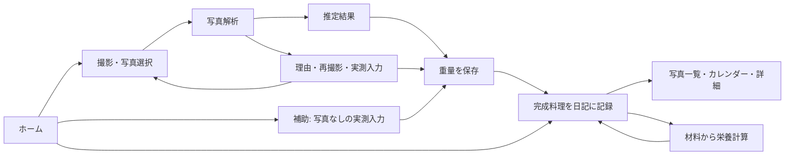

# Pasta Lens 統合リリース — 2026-11-11

## 今回の実装範囲

既存の食事日記、乾麺測定、栄養計算を維持し、未統合の共通CSS・手動重量入力・A4補助シート・研究用データ登録を通常アプリの画面構成へ統合する。一般利用のホーム／記録／設定と、設定内の開発・検証ツールを分離する。

本番標準の重量推定は既存OpenCV方式のまま。製品校正・対応する撮影状態・画像検出を満たさない場合は数値を出さず、理由、撮り直し、実測重量入力、校正設定への導線を表示する。方式Bの独立試料での精度は未確認であり、本番モデルとして採用しない。料理写真AIも未開発のため写真のみからカロリーを生成しない。

## 修正した操作上の問題

- 検出処理完了と重量推定成功を区別し、重量がないのに成功と見える案内を解消。
- 推定失敗後も実測重量を入力・保存し、食事日記へ進める。写真なしの実測記録は補助手段として表示。
- 推定と実測は別の列に保存し、実測のみの場合の推定重量はNULL。取得方式はmanual_weight、CGはsyntheticとして保持。
- 製品の栄養情報がない場合はNULLと「未計算」。推定成功時も架空の0 kcalで保存しない。
- 実測のみの乾麺履歴から、材料を使った料理計算へ進める。従来の推定重量必須という制約を修正。
- 保存済みの食事写真は、コミット直後の応答異常でも削除しない。書き込みが未確定と確認できる場合だけ新規写真を掃除する。
- 校正設定から戻った際は製品を再読込し、同じ解析要求の検出結果をセッション内で再利用する。
- 研究用の小さすぎる画像や診断失敗で登録画面を停止させない。確認できない品質を「撮影OK」と扱わない。

## データ設計と保護

既存measurements／cooking_sessions／meal_entriesを維持する。実測のみ・栄養未計算の保存で必要な場合、測定テーブルの推定重量・栄養値のNOT NULL制約をバックアップ後に原子的に緩和する。既存行、ID、インデックス、トリガー、外部キーを保持し、移行失敗時はロールバックする。

食事日記は食べた日時と登録日時を区別し、関連する測定・料理栄養計算のスナップショットを保持する。日記の登録・編集で元の測定記録は変更しない。同じ乾麺を別の料理へ二重計上する制約は維持する。保存IDによる二重送信防止も維持する。

研究用DBと写真は別保存先。登録時の学習承認は常に無効。再利用・追加・不明な試料の関係を保守的に管理する。原本とプレビューは別のSHA-256を持つ。A4マーカーが検出できても、印刷倍率と平面条件の確認がなければ寸法精度を保証しない。

公開対象はコード・合成テスト・手順書・A4 PDF/SVGのみ。個人写真、SQLite、学習済みモデル、実測台帳、バックアップ、ローカル画面検証データは公開しない。パス検査と一般的な認証トークン／秘密鍵形式の内容検査を実施する。自動検査があらゆる秘密情報を検出する保証はないため、公開差分も確認する。

## Windows起動と更新

Python 3.12で、ルートのsetup_windows.bat→start_windows.bat。専用.venvにのみ依存を入れる。PCのブラウザを起動し、標準ではlocalhostのみ待受する。スマホ接続はstart_lan.batから明示的に有効化し、信頼する家庭内Wi-Fiのみ使用する。詳しくはREADME_JA.mdとSMARTPHONE_JA.md。

旧版のフォルダーに新しいZIPを上書きしない。新しいフォルダーへ展開し、まず空の保存先で試す。既存記録を引き継ぐ場合は旧・新アプリを終了し、旧保存フォルダー全体を別の場所へコピーしてバックアップする。移行元が旧版のpasta_weight_app_v2/dataか、旧配布版のuser_dataかを確認し、新版user_dataが空であることを確認してからフォルダー内容をコピーする。DBだけでなくphotos・meal_photos・研究用データ等も一緒に保持する。異なる2つの保存先を手動で混ぜない。

## 復旧・ロールバック

1. アプリを終了する。新しい記録を含む現在の保存先を別名で退避する。
2. 移行前のバックアップフォルダーを新しい空フォルダーへ複製する。稼働中のDBへ上書きしない。
3. 旧バージョンは移行前データの複製に対して起動する。手動重量NULLに非対応の旧コードで新DBを開かない。
4. DB単体の移行失敗時は同じフォルダーの`.before-manual-weight-*.backup`等から、アプリ停止後に復元用の新しい保存先へDBをコピーする。写真は対応する元のフォルダーを維持する。
5. コード上の問題をmainで取り消す場合は、該当コミットを`git revert <commit>`で取り消す通常のコミットを作る。reset／強制pushで公開履歴を破壊しない。データの復元はコードのrevertと別に扱う。

## 検証記録

最終の自動テスト件数、Chromiumの確認対象、公開mainのコミット、配布ZIPの情報は検証完了後に追記する。全テストには既存履歴を保持する移行、二重保存、保存失敗、実測→料理計算→日記、栄養未計算、研究用の未承認管理、方式Bの漏洩拒否、配布物検査を含める。

実際のWindows、iPhone Safariのカメラ・キーボード・LAN接続、紙に印刷したA4シート、新しい独立試料での重量推定精度は今回の実行環境では未検証。通信切断やブラウザ終了時の未保存の入力は保持を保証しない。接続中の画面移動については草稿を維持する。無認証の外部公開運用は対象外。

## 最終確認（2026-11-11）

- 自動テスト：**490件成功**。実行コマンド：`python -m pytest -q pasta_weight_app_v2/tests pasta_weight_app_v2/experiments/research_tests tools/tests`。通常アプリ・保存・移行・UI・方式B研究・配布検査を含む。失敗を検出した回帰テストからコードを修正し、全件を再実行した。
- Chromium：**8ケース成功**。幅1280/390px×ライト/ダークの4表示、手動100g→350kcal→保存失敗→再試行→料理計算→写真付き日記→編集・検索・カレンダー・削除、写真なし・栄養未計算の記録、破損画像/未検出/モデルなしからの復帰、研究登録/QC/失敗復旧/メタデータ衝突/同一条件の重複防止。
- 表示確認にはホーム・撮影・重量結果・日記・設定・研究登録・A4 PDFダウンロードを含む。スクリーンショットは合成画像と専用一時DBで作成し、Gitとは別の成果物として提供する。
- 元の保護対象6,329ファイルで変更・削除0件。バックアップ済み。公開GitとWindows ZIPに個人写真・SQLite・台帳・学習済みモデルを含めない。
- Windows CPython3.12/64bit向けに、全ランタイム依存のwheel解決とダウンロードに成功。ソース版・配布版のrequirements相対パスを別々に検査し、ソース版のpip dry-runも成功。Windows上でインストール・bat実行したという意味ではない。
- Linuxの専用仮想環境でpip check成功。通常推定に方式Bを組み込む変更、モデルの再学習、新たな実写精度評価は行っていない。

## 画面・機能・データの対応（設計書への反映）

| 画面 | 操作 | 保存・参照先 |
|---|---|---|
| ホーム→撮影→結果 | 写真解析、推定結果、実測入力、保存 | measurements、photos、製品スナップショット |
| ホームの補助操作 | 写真なしの実測重量 | measurements（estimated_g=NULL、manual_weight） |
| 記録→食事日記 | 写真/日時/料理名/メモ、カレンダー、検索、編集・削除 | meal_entries、meal_photos、測定・栄養スナップショット |
| 設定→料理の栄養計算 | 乾麺と材料・取り分けの計算 | cooking_sessions、cooking_ingredients、recipe_templates |
| 設定→開発・検証 | 未承認写真/QC/試料関係/A4ガイド | 別のresearch_collection DB・原本・プレビュー |

基本設計Ver.2の撮影・重量推定・栄養・食品管理・履歴・エラー案内を維持する。追加の食事日記と写真保存、実測のみのNULL表現、補助入力・復帰導線、別DBの研究登録は詳細設計の画面遷移・機能一覧・データ関係に反映する。料理写真AIは将来拡張であり実装済みとして図示しない。
